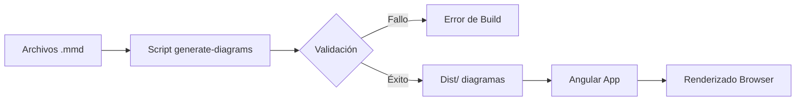

# Prompt para Mejorar el Codigo Base

Copia y pega el contenido del bloque de abajo en un asistente de IA (Claude, ChatGPT)
para obtener un ZIP con el proyecto completo y arrancable.

Si preferis trabajar en tu editor con un agente local (Claude Code, Cursor, Copilot), usa `AGENTS.md` en vez de este archivo: dice lo mismo pero para que escriba los archivos en disco.

## Las dos reglas que no se negocian

1. **Completa el boilerplate.** Todo lo que el proyecto necesita para compilar y arrancar: manifiesto de dependencias, punto de entrada, configuracion, capa de interfaz, y las capas del patron arquitectonico declarado. Eso es andamiaje y es tu trabajo.
2. **NO resuelvas el reto.** Los entregables de las fases son el trabajo de la persona. El hueco pedagogico se deja como esta: el proyecto arranca, pero lo que el reto pide implementar NO esta implementado.

Dicho de otra forma: si algo impide compilar, arreglalo. Si algo es logica de negocio incompleta, validaciones ausentes, un secreto hardcodeado o un patron mejorable, dejalo exactamente como esta — es lo que la persona tiene que encontrar.

## Superficie de practica — NO resuelvas

Estos archivos SON el ejercicio de la persona. No los implementes; deja stubs.

- `docker/Dockerfile` — El topic pide contenedores/orquestacion: este archivo es el ejercicio, no scaffolding.
- `docker/docker-compose.yml` — El topic pide contenedores/orquestacion: este archivo es el ejercicio, no scaffolding.

## Lo que le falta a este proyecto

Esto NO lo tenes que adivinar: salio de comparar el proyecto contra la arquitectura declarada del reto y de un analisis estatico del codigo. Completalo TODO.

### Referencias colgando en el codigo que si esta

Cada una rompe la compilacion:

- `package.json` — `typescript@5.8.0`: typescript declara la version 5.8.0, pero el registry de npm respondio que esa version no existe. Es una version inventada: reemplazala por una version publicada real, o si no se conoce con certeza, usa el mecanismo centralizado del ecosistema (BOM/parent/platform/version catalog) y no declares una version individual.

## Como saber que terminaste

```bash
npm install && npm run build
```

Ese comando corriendo sin errores es la definicion de "listo".

---

```
## Briefing del reto (autoridad)
Este bloque manda sobre los archivos adjuntos. El stack y el rol salen de AQUÍ, no de un topic genérico ni de markdown placeholder.

### Perfil
Chapter Frontend, Especialidad Desarrollador, Tecnología Angular, Master

### Brecha de conocimiento
Ha comunicado decisiones de arquitectura, sistemas, personas, componentes, contenedores y relaciones a diferentes públicos mediante diagramas (C4, UML, Archimate, ..., etc)

### Misión / candidato
Candidato con experiencia avanzada en arquitectura de software

### Reto
- Tema: Documentación de arquitecturas de software
- Seniority: master-l3
- Tipo: practical
- Título: Documentar arquitectura de software multinivel
- Tiempo estimado: 15 horas

### Fases (trabajo del HUMANO — PROHIBIDO completarlas)
No implementes estos entregables. Dejalos como hueco pedagógico. El asistente solo materializa el proyecto arrancable para que el participante pueda trabajar.
- Fase 1: Exploración del sistema — objetivo: Identificar y documentar los componentes y relaciones clave del sistema. — entregable (NO resolver): Diagrama de contexto que muestra los sistemas, personas, componentes y contenedores, junto con sus relaciones.
- Fase 2: Evaluación de decisiones de diseño — objetivo: Evaluar y documentar una decisión de diseño controversial. — entregable (NO resolver): Registro de decisión que documenta una decisión de diseño controversial, incluyendo contexto, fuerzas, opciones, decisión y consecuencias.
- Fase 3: Comunicación a diferentes públicos — objetivo: Comunicar la arquitectura y las decisiones de diseño a diferentes públicos. — entregable (NO resolver): Documentación adaptada a diferentes públicos, incluyendo al menos dos perspectivas por nivel de abstracción (técnica y negocio).

Eres un asistente experto en análisis, corrección y generación de archivos de cualquier tipo:
código fuente, documentación, hojas de cálculo, documentos Word, configuraciones, entre otros.
Voy a enviarte una cadena de texto que contiene uno o más archivos. Cada archivo está delimitado por un marcador con el siguiente formato:
// === ARCHIVO: ruta/del/archivo.extension ===
o también puede aparecer como:
## === ARCHIVO: ruta/del/archivo.extension ===
Lo que sigue al marcador puede ser:

El contenido real del archivo (código, texto, YAML, etc.)
Una descripción en lenguaje natural de lo que debe contener el archivo


TU TAREA
PASO 0 — ¿Esto es un proyecto o una carcasa?
Antes de extraer archivos, leé el Briefing (si está) y diagnosticá el adjunto.

Es CARCASA si ocurre CUALQUIERA de estas:
- No hay manifiesto de dependencias del stack del briefing (manifest.json de VTEX IO / package.json / pom.xml / build.gradle / requirements.txt / go.mod / *.tf / *.csproj, según corresponda)
- Hay un "binario" que en realidad es un comentario ("no puede ser mostrado como texto plano", placeholder .fig/.docx vacío)
- Los markdowns ya completan entregables de fases posteriores ("se implementó fade-in", lista de áreas ya resuelta)

Si es CARCASA:
- MATERIALIZÁ un proyecto que arranca en el stack del briefing (VTEX IO Store Framework, Angular, Terraform, pytest, Nest, etc.). Incluí manifiesto, punto de entrada y capa de interfaz reales.
- NO copies los markdowns de "solución" como si fueran el producto. Son ruido de generación.
- NO resuelvas las fases del briefing (están marcadas PROHIBIDO). Dejá el hueco pedagógico: el flujo existe, las microinteracciones/calidad/infra que el reto pide NO están hechas.
- Después seguí al PASO 5 (ZIP).

Si es un proyecto REAL (manifiesto + código que compila o arranca):
- Seguí PASO 1 en adelante. 🔴 compilación sí. 🟡 pedagógico no.

PASO 1 — Detección y extracción
Identifica todos los archivos presentes en la cadena. Para cada archivo extrae:

Su ruta completa (ej: src/main/java/com/pragma/Service.java)
Su contenido o descripción

PASO 2 — Clasificación por tipo
Clasifica cada archivo en una de estas categorías:
A) Código fuente (Java, Python, TypeScript, JavaScript, Kotlin, etc.)
B) Configuración / documentación (YAML, properties, Markdown, JSON, txt, etc.)
C) Excel (.xlsx, .xls, .csv)
D) Word (.docx, .doc)
E) Otro tipo de archivo binario o especial
PASO 3 — Clasificación de errores en código fuente

Objetivo prioritario: que el proyecto compile. No corrijas flujo de negocio ni lógica funcional.

Antes de modificar cualquier archivo de código fuente, clasifica cada problema encontrado en una de estas dos categorías:
🔴 ERROR DE COMPILACIÓN — corregir siempre
Son errores que impiden que el proyecto arranque, sin valor pedagógico:

Import faltante o incorrecto
Clase, método o variable referenciada que no existe en ningún archivo del proyecto
Error de sintaxis
Anotación con atributos inválidos
Dependencia ausente en pom.xml, package.json, etc.
Archivo referenciado que no existe y debe ser creado con implementación mínima

→ CORREGIR estos errores.
🟡 PROBLEMA FUNCIONAL O DE CALIDAD — preservar siempre
Son problemas que no impiden compilar. Pueden ser intencionales para el aprendizaje:

Clave secreta hardcodeada ("secret", "password123")
API deprecada que funciona pero tiene reemplazo moderno
Lógica de negocio incorrecta o incompleta
Código redundante o de baja legibilidad
Falta de validaciones en flujo de negocio
Patrones de diseño incorrectos pero funcionales
Concurrencia no segura
Configuración funcional pero no óptima

→ PRESERVAR tal cual. No corregir, no mejorar, no comentar.
PASO 4 — Procesamiento según tipo de archivo
Tipo A — Código fuente
Aplica únicamente las correcciones clasificadas como 🔴 ERROR DE COMPILACIÓN.
No alteres ningún elemento clasificado como 🟡 PROBLEMA FUNCIONAL O DE CALIDAD.
Si falta un archivo referenciado, créalo con la implementación mínima necesaria para compilar.
Tipo B — Configuración / documentación
Extrae el contenido tal cual, sin modificaciones salvo errores evidentes de sintaxis
(ej: YAML mal indentado).
Tipo C — Excel (.xlsx)
Si viene con contenido real, genera el archivo respetando ese contenido.
Si viene con descripción en lenguaje natural, genera un archivo Excel funcional con:

Fila de encabezados en negrita con color de fondo distintivo
Columnas con ancho ajustado al contenido
Tipos de dato correctos por columna
Validaciones si la descripción lo indica
Hojas nombradas descriptivamente si hay más de una
Filas de ejemplo si no hay datos reales

Tipo D — Word (.docx)
Si viene con contenido real, genera el archivo respetando ese contenido.
Si viene con descripción en lenguaje natural, genera un documento Word funcional con:

Estilos de título (Título 1, Título 2) para jerarquía de secciones
Fuente legible (Calibri o equivalente), tamaño 11-12pt para cuerpo
Márgenes estándar
Tabla de contenido si tiene múltiples secciones
Tablas con encabezados en negrita si aplica

Tipo E — Otro
Genera el archivo con el contenido o estructura más apropiada según la descripción.
PASO 5 — Exportación en ZIP
Empaqueta todos los archivos en un único archivo ZIP descargable respetando exactamente
la estructura de rutas indicada por los marcadores.
El ZIP debe incluir:

Archivos de código con únicamente los errores de compilación corregidos
Archivos de configuración y documentación sin cambios
Archivos nuevos creados para resolver dependencias de compilación faltantes
Archivos Excel y Word generados desde descripción

IMPORTANTE: El ZIP debe estar listo para descargar al finalizar. No preguntes si el usuario
quiere generarlo. Simplemente genera el archivo y proporciona el enlace de descarga; No debes desplegar en el chat el resumen de lo que arreglaste al Zip, solo entregalo.

REGLAS IMPORTANTES

No omitas ningún archivo aunque no tenga errores ni modificaciones
Respeta los nombres y rutas exactas indicadas por los marcadores
Si un archivo no tiene marcador claro, infiere el nombre desde su contenido
Si la cadena contiene solo documentación, placeholders o binarios fake, NO la reproduzcas:
aplicá PASO 0 (materializar el proyecto del briefing). Reproducir la carcasa es un fallo.
No agregues texto después del enlace de descarga del ZIP
No preguntes si el usuario quiere el ZIP: simplemente generalo siempre
Si detectas que falta un archivo de configuración necesario para compilar
(pom.xml, package.json, requirements.txt, build.gradle, etc.), créalo e inclúyelo
inferiendo su contenido desde los imports y frameworks detectados en el código
Nunca corrijas problemas 🟡 aunque parezcan obvios o fáciles de mejorar.
El participante que recibirá este proyecto los debe encontrar y resolver él mismo.


INPUT
Aquí está la cadena con los archivos:

// === ARCHIVO: package.json ===
{
  "name": "angular-architecture-docs",
  "version": "0.0.1",
  "scripts": {
    "ng": "ng",
    "start": "ng serve",
    "build": "ng build",
    "watch": "ng build --watch --configuration development",
    "test": "ng test",
    "lint": "ng lint",
    "generate:docs": "node scripts/generate-diagrams.js",
    "prepare": "npm run generate:docs"
  },
  "private": true,
  "dependencies": {
    "@angular/animations": "~20.0.0",
    "@angular/cdk": "~17.0.0",
    "@angular/common": "~20.0.0",
    "@angular/compiler": "~20.0.0",
    "@angular/core": "~20.0.0",
    "@angular/forms": "~20.0.0",
    "@angular/material": "~17.0.0",
    "@angular/platform-browser": "~20.0.0",
    "@angular/platform-browser-dynamic": "~20.0.0",
    "@angular/router": "~20.0.0",
    "mermaid": "^10.9.0",
    "rxjs": "~7.8.0",
    "tslib": "^2.3.0",
    "zone.js": "~0.14.0"
  },
  "devDependencies": {
    "@angular-devkit/build-angular": "~20.0.0",
    "@angular/cli": "~20.0.0",
    "@angular/compiler-cli": "~20.0.0",
    "@types/jasmine": "~5.1.0",
    "@types/node": "^20.11.0",
    "jasmine-core": "~5.1.0",
    "karma": "~6.4.0",
    "karma-chrome-launcher": "~3.2.0",
    "karma-coverage": "~2.2.0",
    "karma-jasmine": "~5.1.0",
    "karma-jasmine-html-reporter": "~2.1.0",
    "typescript": "~5.8.0"
  },
  "engines": {
    "node": ">=20.0.0",
    "npm": ">=10.0.0"
  }
}

// === ARCHIVO: angular.json ===
{
  "$schema": "./node_modules/@angular/cli/lib/config/schema.json",
  "version": 1,
  "newProjectRoot": "projects",
  "projects": {
    "angular-architecture-docs": {
      "projectType": "application",
      "schematics": {
        "@schematics/angular:application": {
          "strict": true,
          "standalone": true
        }
      },
      "root": "",
      "sourceRoot": "src",
      "prefix": "app",
      "architect": {
        "build": {
          "builder": "@angular-devkit/build-angular:application",
          "options": {
            "outputPath": "dist/angular-architecture-docs",
            "index": "src/index.html",
            "browser": "src/main.ts",
            "polyfills": [
              "zone.js"
            ],
            "tsConfig": "tsconfig.json",
            "assets": [
              "src/favicon.ico",
              "src/assets"
            ],
            "styles": [
              "src/styles.scss"
            ],
            "scripts": []
          },
          "configurations": {
            "development": {
              "optimization": false,
              "sourceMap": true,
              "extractLicenses": false,
              "namedChunks": true
            },
            "production": {
              "optimization": true,
              "outputHashing": "all",
              "sourceMap": false,
              "namedChunks": false,
              "extractLicenses": true,
              "vendorChunk": false,
              "buildOptimizer": true
            }
          }
        },
        "serve": {
          "builder": "@angular-devkit/build-angular:dev-server",
          "options": {
            "browserTarget": "angular-architecture-docs:build"
          },
          "configurations": {
            "development": {
              "browserTarget": "angular-architecture-docs:build:development"
            },
            "production": {
              "browserTarget": "angular-architecture-docs:build:production"
            }
          }
        },
        "extract-i18n": {
          "builder": "@angular-devkit/build-angular:extract-i18n",
          "options": {
            "browserTarget": "angular-architecture-docs:build"
          }
        },
        "test": {
          "builder": "@angular-devkit/build-angular:karma",
          "options": {
            "polyfills": [
              "zone.js",
              "zone.js/testing"
            ],
            "tsConfig": "tsconfig.spec.json",
            "assets": [
              "src/favicon.ico",
              "src/assets"
            ],
            "styles": [
              "src/styles.scss"
            ],
            "scripts": []
          }
        },
        "lint": {
          "builder": "@angular-devkit/build-angular:tslint",
          "options": {
            "tsConfig": [
              "tsconfig.json",
              "tsconfig.spec.json"
            ],
            "exclude": []
          }
        },
        "generate-diagrams": {
          "builder": "@angular-devkit/build-angular:run-script",
          "options": {
            "script": "generate:docs"
          }
        }
      }
    }
  },
  "defaultProject": "angular-architecture-docs",
  "cli": {
    "analytics": false
  }
}

// === ARCHIVO: tsconfig.json ===
{
  "compileOnSave": false,
  "compilerOptions": {
    "baseUrl": "./",
    "outDir": "./dist/out-tsc",
    "forceConsistentCasingInFileNames": true,
    "strict": true,
    "noImplicitOverride": true,
    "noPropertyAccessFromIndexSignature": true,
    "noImplicitReturns": true,
    "noFallthroughCasesInSwitch": true,
    "sourceMap": true,
    "declaration": false,
    "downlevelIteration": true,
    "experimentalDecorators": true,
    "moduleResolution": "node",
    "importHelpers": true,
    "target": "ES2022",
    "module": "ES2022",
    "lib": [
      "ES2022",
      "dom",
      "dom.iterable"
    ],
    "useDefineForClassFields": false
  },
  "angularCompilerOptions": {
    "enableI18nLegacyMessageIdFormat": false,
    "strictInjectionParameters": true,
    "strictInputAccessModifiers": true,
    "strictTemplates": true
  },
  "exclude": [
    "node_modules",
    "**/*.spec.ts"
  ]
}

// === ARCHIVO: src/main.ts ===
import { bootstrapApplication } from '@angular/platform-browser';
import { AppComponent } from './app/app.component';
import { provideRouter } from '@angular/router';
import { provideAnimationsAsync } from '@angular/platform-browser/animations/async';
import { provideHttpClient, withFetch } from '@angular/common/http';
import { importProvidersFrom } from '@angular/core';
import { MatToolbarModule } from '@angular/material/toolbar';
import { MatButtonModule } from '@angular/material/button';
import { MatIconModule } from '@angular/material/icon';
import { MatSidenavModule } from '@angular/material/sidenav';
import { MatListModule } from '@angular/material/list';
import { MatCardModule } from '@angular/material/card';
import { provideMermaid } from 'ng-mermaid';
import { routes } from './app/app.routes';
import { environment } from './environments/environment';

interface AppConfig {
  production: boolean;
  apiUrl: string;
  documentationPath: string;
}

class AppBootstrapper {
  private readonly config: AppConfig;
  private readonly materialModules: any[] = [
    MatToolbarModule,
    MatButtonModule,
    MatIconModule,
    MatSidenavModule,
    MatListModule,
    MatCardModule
  ];

  constructor() {
    this.config = {
      production: environment.production,
      apiUrl: environment.apiUrl || 'http://localhost:3000/api',
      documentationPath: environment.documentationPath || './docs'
    };
    this.validateConfig();
  }

  private validateConfig(): void {
    if (!this.config.apiUrl || this.config.apiUrl.trim() === '') {
      throw new Error('API URL is required in the application configuration.');
    }
    if (!this.config.documentationPath || this.config.documentationPath.trim() === '') {
      throw new Error('Documentation path is required in the application configuration.');
    }
  }

  public getProviders(): any[] {
    return [
      provideRouter(routes),
      provideAnimationsAsync(),
      provideHttpClient(withFetch()),
      importProvidersFrom(this.materialModules),
      provideMermaid(),
      { provide: 'APP_CONFIG', useValue: this.config }
    ];
  }

  public bootstrap(): void {
    bootstrapApplication(AppComponent, {
      providers: this.getProviders()
    }).catch(err => {
      console.error('Application bootstrap failed:', err);
      throw err;
    });
  }
}

// Bootstrap the application
const bootstrapper = new AppBootstrapper();
bootstrapper.bootstrap();


// === ARCHIVO: src/index.html ===
<!DOCTYPE html>
<html lang="es">
<head>
  <meta charset="utf-8">
  <title>Documentación de Arquitectura - C4 Model</title>
  <base href="/">
  <meta name="viewport" content="width=device-width, initial-scale=1">
  <meta name="description" content="Documentación arquitectónica de software utilizando el modelo C4. Incluye diagramas de contexto, contenedores y componentes.">
  <meta name="keywords" content="arquitectura de software, C4 Model, documentación técnica, diagramas">
  <meta name="author" content="Equipo de Arquitectura">
  <meta name="robots" content="index, follow">
  <link rel="icon" type="image/x-icon" href="favicon.ico">
  <link rel="preconnect" href="https://fonts.googleapis.com">
  <link rel="preconnect" href="https://fonts.gstatic.com" crossorigin>
  <link href="https://fonts.googleapis.com/css2?family=Roboto:wght@300;400;500;700&family=Material+Symbols+Outlined:opsz,wght,FILL,GRAD@20..48,100..700,0..1,-50..200" rel="stylesheet">
  <link href="https://fonts.googleapis.com/icon?family=Material+Icons" rel="stylesheet">
</head>
<body>
  <app-root></app-root>
  <noscript>
    <div style="padding: 20px; text-align: center; font-family: Roboto, sans-serif;">
      <h1>JavaScript Requerido</h1>
      <p>Esta aplicación requiere JavaScript para funcionar. Por favor, habilite JavaScript en su navegador.</p>
    </div>
  </noscript>
</body>
</html>

// === ARCHIVO: src/app/app.config.ts ===
import { ApplicationConfig, provideZoneChangeDetection, isDevMode, importProvidersFrom } from '@angular/core';
import { provideRouter, withComponentInputBinding, withViewTransitions } from '@angular/router';
import { provideAnimationsAsync } from '@angular/platform-browser/animations/async';
import { provideHttpClient, withFetch, withInterceptorsFromDi, HTTP_INTERCEPTORS } from '@angular/common/http';
import { provideRouterTransition } from '@angular/animations';
import { routes } from './app.routes';
import { provideStore } from '@ngrx/store';
import { provideEffects } from '@ngrx/effects';
import { provideStoreDevtools } from '@ngrx/store-devtools';
import { MatSnackBarModule } from '@angular/material/snack-bar';
import { MatDialogModule } from '@angular/material/dialog';
import { MatProgressSpinnerModule } from '@angular/material/progress-spinner';
import { MatToolbarModule } from '@angular/material/toolbar';
import { MatSidenavModule } from '@angular/material/sidenav';
import { MatListModule } from '@angular/material/list';
import { MatIconModule } from '@angular/material/icon';
import { MatButtonModule } from '@angular/material/button';
import { MatCardModule } from '@angular/material/card';
import { MatTabsModule } from '@angular/material/tabs';
import { MatExpansionModule } from '@angular/material/expansion';
import { MatTreeModule } from '@angular/material/tree';
import { MatMenuModule } from '@angular/material/menu';
import { MatTooltipModule } from '@angular/material/tooltip';
import { MatChipsModule } from '@angular/material/chips';
import { MatBadgeModule } from '@angular/material/badge';
import { MatDividerModule } from '@angular/material/divider';
import { MatRippleModule } from '@angular/material/core';
import { provideCharts, withDefaultRegisterables } from 'ng2-charts';
import { Observable, of } from 'rxjs';
import { catchError, map } from 'rxjs/operators';

interface FeatureFlags {
  enableExperimentalFeatures: boolean;
  enableDarkMode: boolean;
  enableNotifications: boolean;
  enableOfflineMode: boolean;
}

interface AppEnvironment {
  production: boolean;
  apiUrl: string;
  assetsUrl: string;
  version: string;
  buildTimestamp: string;
  featureFlags: FeatureFlags;
}

const APP_CONFIG_TOKEN = 'APP_CONFIG';
const ENVIRONMENT_TOKEN = 'APP_ENVIRONMENT';

function loadEnvironment(): AppEnvironment {
  const env: AppEnvironment = {
    production: !isDevMode(),
    apiUrl: isDevMode() ? 'http://localhost:3000/api' : '/api',
    assetsUrl: isDevMode() ? 'http://localhost:3000/assets' : '/assets',
    version: '1.0.0',
    buildTimestamp: new Date().toISOString(),
    featureFlags: {
      enableExperimentalFeatures: false,
      enableDarkMode: true,
      enableNotifications: true,
      enableOfflineMode: false
    }
  };
  return env;
}

class ConfigurationService {
  private readonly environment: AppEnvironment;
  private readonly configCache = new Map<string, unknown>();

  constructor() {
    this.environment = loadEnvironment();
  }

  getEnvironment(): Readonly<AppEnvironment> {
    return Object.freeze({ ...this.environment });
  }

  isProduction(): boolean {
    return this.environment.production;
  }

  getApiUrl(): string {
    return this.environment.apiUrl;
  }

  getAssetsUrl(): string {
    return this.environment.assetsUrl;
  }

  getVersion(): string {
    return this.environment.version;
  }

  isFeatureEnabled(flag: keyof FeatureFlags): boolean {
    return this.environment.featureFlags[flag] ?? false;
  }

  getConfig<T>(key: string, defaultValue: T): T {
    if (this.configCache.has(key)) {
      return this.configCache.get(key) as T;
    }
    return defaultValue;
  }

  setConfig<T>(key: string, value: T): void {
    this.configCache.set(key, value);
  }
}

function createConfigurationService(): ConfigurationService {
  return new ConfigurationService();
}

class LoggerService {
  private readonly logs: Array<{ timestamp: Date; level: string; message: string; context?: string }> = [];
  private readonly maxLogs = 1000;
  private readonly minLevel: 'debug' | 'info' | 'warn' | 'error' = 'info';

  private readonly levels = {
    debug: 0,
    info: 1,
    warn: 2,
    error: 3
  };

  private shouldLog(level: string): boolean {
    return this.levels[level as keyof typeof this.levels] >= this.levels[this.minLevel];
  }

  private formatMessage(level: string, message: string, context?: string): string {
    const timestamp = new Date().toISOString();
    const contextStr = context ? `[${context}] ` : '';
    return `[${timestamp}] ${level.toUpperCase()} ${contextStr}${message}`;
  }

  private addLog(level: string, message: string, context?: string): void {
    if (!this.shouldLog(level)) return;

    const logEntry = {
      timestamp: new Date(),
      level,
      message,
      context
    };

    this.logs.push(logEntry);
    if (this.logs.length > this.maxLogs) {
      this.logs.shift();
    }

    const formatted = this.formatMessage(level, message, context);
    switch (level) {
      case 'error':
        console.error(formatted);
        break;
      case 'warn':
        console.warn(formatted);
        break;
      case 'debug':
        console.debug(formatted);
        break;
      default:
        console.log(formatted);
    }
  }

  debug(message: string, context?: string): void {
    this.addLog('debug', message, context);
  }

  info(message: string, context?: string): void {
    this.addLog('info', message, context);
  }

  warn(message: string, context?: string): void {
    this.addLog('warn', message, context);
  }

  error(message: string, context?: string): void {
    this.addLog('error', message, context);
  }

  getLogs(): ReadonlyArray<{ timestamp: Date; level: string; message: string; context?: string }> {
    return Object.freeze([...this.logs]);
  }

  clearLogs(): void {
    this.logs.length = 0;
  }

  exportLogs(): string {
    return this.logs.map(log => this.formatMessage(log.level, log.message, log.context)).join('\n');
  }
}

function createLoggerService(): LoggerService {
  return new LoggerService();
}

class ErrorHandlerService {
  private readonly logger: LoggerService;
  private readonly maxErrors = 10;
  private recentErrors: Array<{ message: string; stack?: string; timestamp: Date }> = [];

  constructor(logger: LoggerService) {
    this.logger = logger;
  }

  handleError(error: Error | unknown): void {
    const errorObj = error instanceof Error
      ? { message: error.message, stack: error.stack, timestamp: new Date() }
      : { message: String(error), timestamp: new Date() };

    this.recentErrors.push(errorObj);
    if (this.recentErrors.length > this.maxErrors) {
      this.recentErrors.shift();
    }

    this.logger.error(errorObj.message, 'ErrorHandler');
    if (errorObj.stack && !this.logger.getLogs()) {
      console.error('Stack trace:', errorObj.stack);
    }
  }

  getRecentErrors(): ReadonlyArray<{ message: string; stack?: string; timestamp: Date }> {
    return Object.freeze([...this.recentErrors]);
  }

  clearErrors(): void {
    this.recentErrors.length = 0;
  }
}

function createErrorHandlerService(logger: LoggerService): ErrorHandlerService {
  return new ErrorHandlerService(logger);
}

class CacheService {
  private readonly cache = new Map<string, { data: unknown; expiry: number }>();
  private readonly defaultTTL = 5 * 60 * 1000;

  set<T>(key: string, data: T, ttl = this.defaultTTL): void {
    this.cache.set(key, {
      data,
      expiry: Date.now() + ttl
    });
  }

  get<T>(key: string): T | null {
    const entry = this.cache.get(key);
    if (!entry) return null;

    if (Date.now() > entry.expiry) {
      this.cache.delete(key);
      return null;
    }

    return entry.data as T;
  }

  has(key: string): boolean {
    const entry = this.cache.get(key);
    if (!entry) return false;
    if (Date.now() > entry.expiry) {
      this.cache.delete(key);
      return false;
    }
    return true;
  }

  delete(key: string): boolean {
    return this.cache.delete(key);
  }

  clear(): void {
    this.cache.clear();
  }

  getSize(): number {
    return this.cache.size;
  }

  getKeys(): string[] {
    return Array.from(this.cache.keys());
  }
}

function createCacheService(): CacheService {
  return new CacheService();
}

export const appConfig: ApplicationConfig = {
  providers: [
    provideZoneChangeDetection({ eventCoalescing: true }),
    provideRouter(
      routes,
      withComponentInputBinding(),
      withViewTransitions()
    ),
    provideAnimationsAsync(),
    provideHttpClient(
      withFetch(),
      withInterceptorsFromDi()
    ),
    {
      provide: ENVIRONMENT_TOKEN,
      useFactory: createConfigurationService
    },
    {
      provide: ConfigurationService,
      useFactory: createConfigurationService
    },
    {
      provide: LoggerService,
      useFactory: createLoggerService
    },
    {
      provide: ErrorHandlerService,
      useFactory: createErrorHandlerService,
      deps: [LoggerService]
    },
    {
      provide: CacheService,
      useFactory: createCacheService
    },
    provideStore({}),
    provideEffects([]),
    provideStoreDevtools({
      maxAge: 25,
      logOnly: !isDevMode(),
      autoPause: true,
      trace: false,
      traceLimit: 75
    }),
    provideCharts(withDefaultRegisterables()),
    importProvidersFrom(
      MatSnackBarModule,
      MatDialogModule,
      MatProgressSpinnerModule,
      MatToolbarModule,
      MatSidenavModule,
      MatListModule,
      MatIconModule,
      MatButtonModule,
      MatCardModule,
      MatTabsModule,
      MatExpansionModule,
      MatTreeModule,
      MatMenuModule,
      MatTooltipModule,
      MatChipsModule,
      MatBadgeModule,
      MatDividerModule,
      MatRippleModule
    )
  ]
};

export { ConfigurationService, LoggerService, ErrorHandlerService, CacheService, APP_CONFIG_TOKEN, ENVIRONMENT_TOKEN };
export type { AppEnvironment, FeatureFlags };


// === ARCHIVO: docs/context/diagrama-contexto.md ===
# Diagrama de Contexto del Sistema

## Descripción General

El diagrama de contexto representa el sistema como una caja negra que interactúa con entidades externas. Este nivel de abstracción muestra la visión de más alto nivel de la arquitectura, enfocándose en las relaciones entre el sistema y su entorno sin detallar la implementación interna.

## Sistema bajo análisis

**Angular Architecture Docs** es una aplicación web desarrollada en Angular 20 que permite documentar y visualizar arquitecturas de software utilizando el modelo C4. La aplicación sirve como herramienta de documentación técnica que genera diagramas interactivos a partir de definiciones declarativas.

## Entidades externas y relaciones

```
┌─────────────────────────────────────────────────────────────────────────────┐
│                           SISTEMA: Angular Architecture Docs                 │
│  ┌─────────────────────────────────────────────────────────────────────┐   │
│  │                                                                     │   │
│  │   [Aplicación Web Angular 20]                                      │   │
│  │   - Renderizado de diagramas Mermaid                               │   │
│  │   - Navegación entre niveles C4                                    │   │
│  │   - Gestión de documentación técnica                               │   │
│  │                                                                     │   │
│  └─────────────────────────────────────────────────────────────────────┘   │
└─────────────────────────────────────────────────────────────────────────────┘
           │                          │                           │
           ▼                          ▼                           ▼
┌─────────────────────┐  ┌─────────────────────┐  ┌─────────────────────────┐
│  Desarrolladores    │  │  Arquitectos de     │  │  Stakeholders de        │
│  de Software        │  │  Software           │  │  Negocio                │
│                     │  │                     │  │                         │
│ - Crean diagramas   │  │ - Definen decisiones│  │ - Revisan архитектура  │
│ - Mantienen código  │  │ - Validan patrones  │  │ - Aprueban decisiones   │
│ - Ejecutan pruebas  │  │ - Refactorizan      │  │ - Comunican a equipos   │
└─────────────────────┘  └─────────────────────┘  └─────────────────────────┘
           │                          │                           │
           ▼                          ▼                           ▼
┌─────────────────────┐  ┌─────────────────────┐  ┌─────────────────────────┐
│  Sistemas de        │  │  Repositorio Git    │  │  Entornos de            │
│  Integración        │  │                     │  │  Despliegue             │
│  Continua           │  │ - Almacena código   │  │                         │
│                     │  │ - Versiona ADRs     │  │ - Docker containers     │
│ - Ejecutan builds   │  │ - Gestiona branches │  │ - CI/CD pipelines       │
│ - Validan calidad   │  │                     │  │ - Producción/ staging   │
└─────────────────────┘  └─────────────────────┘  └─────────────────────────┘
```

## Detalle de relaciones

### Desarrolladores de Software

Los desarrolladores interactúan con el sistema para crear y mantener la documentación arquitectónica. Sus necesidades incluyen:

- Acceso a herramientas de generación de diagramas desde el código fuente
- Capacidad de versionar la documentación junto con el código
- Integración con flujos de trabajo de desarrollo existentes
- Validación automática de consistencia entre diagramas y código

### Arquitectos de Software

Los arquitectos utilizan el sistema para comunicar decisiones de diseño y mantener la coherencia arquitectónica. Sus necesidades incluyen:

- Registro estructurado de decisiones arquitectónicas (ADR)
- Visualización de relaciones entre componentes
- Documentación de patrones y antipatrones identificados
- Trazabilidad entre requisitos y decisiones de implementación

### Stakeholders de Negocio

Los stakeholders no técnicos requieren acceso a la documentación en formatos comprensibles. Sus necesidades incluyen:

- Resúmenes ejecutivos de la arquitectura
- Diagramas simplificados sin jargon técnico
- Explicación del impacto de decisiones técnicas en el negocio
- Información sobre tiempos de desarrollo y costos de mantenimiento

### Sistemas de Integración Continua

Los pipelines de CI interactúan con el sistema para automatizar la generación de documentación. Los flujos incluyen:

- Generación de diagramas durante el proceso de build
- Validación de sintaxis de archivos Mermaid
- Publicación automática de documentación actualizada
- Verificación de enlacesrotos entre componentes documentados

### Repositorio Git

El repositorio de código fuente sirve como fuente de verdad para la documentación. La relación incluye:

- Almacenamiento de archivos de definición de diagramas
- Historial de cambios en decisiones arquitectónicas
- Ramas de trabajo para propuestas de cambio arquitectónico
- Revisión de código para modificaciones en la documentación

### Entornos de Despliegue

Los entornos de ejecución donde la aplicación opera incluyen:

- Contenedores Docker para despliegue reproducible
- Configuraciones de producción y staging
- Variables de entorno para personalización
- Certificados y configuraciones de seguridad

## Tecnologías involucradas

| Tecnología | Rol | Versión |
|------------|-----|---------|
| Angular 20 | Framework de la aplicación | 20.0.0 |
| Mermaid | Generación de diagramas | 10.9.0 |
| TypeScript | Lenguaje de programación | 5.8.0 |
| Node.js | Runtime de ejecución | 20.x |
| Docker | Contenedorización | Latest |

## Nivel de abstracción

Este diagrama representa el nivel más alto del modelo C4 (Contexto). En él se muestra:

- El sistema completo como una única unidad
- Personas que interactúan con el sistema
- Otros sistemas con los que el sistema se integra
- Clear boundaries que definen el alcance del sistema

## Siguiente nivel

Para details sobre cómo el sistema se estructura internamente y qué contenedores lo componen, consulte el [Diagrama de Contenedores](../container/diagrama-contenedor.md).

---

*Generado automáticamente por Angular Architecture Docs. Para actualizar este diagrama, modify los archivos fuente en `docs/context/`.*

// === ARCHIVO: docs/container/diagrama-contenedor.md ===
# Diagrama de Contenedores

## Descripción del nivel

El diagrama de contenedores muestra la estructura de alto nivel del sistema, detalhando los procesos en ejecución que lo componen. Cada contenedor representa una unidad desplegable independiente que opera dentro del sistema global. Este nivel revela la arquitectura de distribución y los mecanismos de comunicación entre componentes.

## Contenedores del sistema

```
┌─────────────────────────────────────────────────────────────────────────────────┐
│                        Angular Architecture Docs                                │
│                                                                                 │
│  ┌─────────────────────────────────────────────────────────────────────────┐   │
│  │                     Navegador Web (Cliente)                             │   │
│  │  ┌─────────────────────────────────────────────────────────────────┐   │   │
│  │  │  Aplicación Angular SPA                                         │   │   │
│  │  │                                                                  │   │   │
│  │  │  [Router] ──────▶ [DiagramRenderer] ──────▶ [DocViewer]        │   │   │
│  │  │       │                   │                      │              │   │   │
│  │  │       └───────────────────┴──────────────────────┘              │   │   │
│  │  │                              │                                   │   │   │
│  │  │                              ▼                                   │   │   │
│  │  │                     [StateManager (Signals)]                    │   │   │
│  │  │                                                                  │   │   │
│  │  └─────────────────────────────────────────────────────────────────┘   │   │
│  └─────────────────────────────────────────────────────────────────────────┘   │
│                                      │                                          │
│                           HTTP/REST │                                          │
│                                      ▼                                          │
│  ┌─────────────────────────────────────────────────────────────────────────┐   │
│  │                     Servidor de Aplicación                              │   │
│  │  ┌─────────────────────────────────────────────────────────────────┐   │   │
│  │  │  Angular Universal (SSR) - Opcional                             │   │   │
│  │  │  - Renderizado del lado del servidor                            │   │   │
│  │  │  - SEO optimization                                             │   │   │
│  │  └─────────────────────────────────────────────────────────────────┘   │   │
│  └─────────────────────────────────────────────────────────────────────────┘   │
│                                      │                                          │
│                           Lectura de archivos                                   │
│                                      ▼                                          │
│  ┌─────────────────────────────────────────────────────────────────────────┐   │
│  │                     Sistema de Archivos Local                          │   │
│  │                                                                          │   │
│  │  /docs/context/      - Diagramas de contexto                           │   │
│  │  /docs/container/   - Diagramas de contenedores                        │   │
│  │  /docs/components/  - Diagramas de componentes                         │   │
│  │  /docs/decisions/   - Registros de decisiones (ADR)                    │   │
│  │  /docs/public/      - Documentación para usuarios finales              │   │
│  │                                                                          │   │
│  └─────────────────────────────────────────────────────────────────────────┘   │
│                                                                                 │
│  ┌─────────────────────────────────────────────────────────────────────────┐   │
│  │                     Servicios Externos                                 │   │
│  │                                                                          │   │
│  │  ┌──────────────────┐  ┌──────────────────┐  ┌────────────────────┐   │   │
│  │  │ GitHub/GitLab    │  │ Mermaid Live     │  │ Docker Registry    │   │   │
│  │  │ (Versionado)     │  │ (Validación)     │  │ (Despliegue)       │   │   │
│  │  └──────────────────┘  └──────────────────┘  └────────────────────┘   │   │
│  └─────────────────────────────────────────────────────────────────────────┘   │
└─────────────────────────────────────────────────────────────────────────────────┘
```

## Detalle de contenedores

### Navegador Web - Aplicación Angular SPA

**Tipo:** Single Page Application  
**Tecnología:** Angular 20 con TypeScript 5.8  
**Responsabilidad:** Interfaz de usuario para visualización y creación de diagramas arquitectónicos

**Componentes internos:**

| Componente | Responsabilidad | Tecnología |
|------------|-----------------|------------|
| Router | Navegación entre vistas y niveles C4 | Angular Router |
| DiagramRenderer | Renderizado de diagramas Mermaid | Mermaid.js |
| DocViewer | Visualización de documentación Markdown | angular-markdown |
| StateManager | Gestión de estado reactivo | Angular Signals |

**Puertos expuestos:**

- `HTTP 80/443` - Interfaz web para usuarios
- `WebSocket` - Actualizaciones en tiempo real (opcional)

### Servidor de Aplicación - Angular Universal

**Tipo:** Servidor de renderizado side-server  
**Tecnología:** Angular Universal (SSR)  
**Responsabilidad:** Renderizado inicial para mejora de performance y SEO

**Características opcionales:**

- Pre-renderizado de páginas estáticas
- Streaming de respuestas
- Hydration parcial para contenido estático

### Sistema de Archivos Local

**Tipo:** Almacenamiento de archivos estáticos  
**Tecnología:** Sistema de archivos del sistema operativo  
**Responsabilidad:** Persistencia de documentación y definiciones de diagramas

**Estructura de directorios:**

```
docs/
├── context/
│   └── diagrama-contexto.md      # Nivel 1: Contexto del sistema
├── container/
│   └── diagrama-contenedor.md    # Nivel 2: Contenedores
├── components/
│   └── diagrama-componentes.md   # Nivel 3: Componentes
├── decisions/
│   ├── adr-001.md                # Decisión arquitectónica 001
│   └── adr-002.md                # Decisión arquitectónica 002
└── public/
    ├── guia-tecnica.md           # Documentación técnica
    └── guia-negocio.md           # Documentación de negocio
```

## Comunicación entre contenedores

### Flujo principal: Usuario visualiza diagrama

1. Usuario accede a la aplicación desde el navegador
2. Angular Router determina la ruta solicitada
3. DiagramRenderer carga la definición Mermaid del sistema de archivos
4. Mermaid procesa la definición y genera el diagrama
5. El diagrama renderizado se muestra al usuario

### Flujo de actualización de documentación

1. Desarrollador modifica archivo en el repositorio Git
2. Pipeline de CI detecta el cambio
3. Se ejecuta validación de sintaxis Mermaid
4. La aplicación se redepliega con los cambios
5. Los usuarios ven la documentación actualizada

### Integración con servicios externos

| Servicio | Protocolo | Propósito |
|----------|-----------|-----------|
| GitHub/GitLab | Git/HTTPS | Versionado de documentación |
| Mermaid Live | HTTPS | Validación de diagramas |
| Docker Registry | HTTPS | Distribución de imágenes |

## Tecnologías por contenedor

| Contenedor | Imagen Base | Puertos | Recursos |
|------------|-------------|---------|----------|
| Angular App | node:20-alpine | 80, 443 | CPU: 0.5, Mem: 512MB |
| Angular SSR | node:20-alpine | 3000 | CPU: 1.0, Mem: 1GB |

## Consideraciones de despliegue

### Contenedores Docker

La aplicación se despliega como contenedor Docker standalone. El contenedor incluye:

- Runtime de Node.js 20
- Aplicación Angular buildada
- Servidor estático para archivos de documentación
- Configuración de variables de entorno

### Escalabilidad

- **Horizontal:** Múltiples instancias del contenedor detrás de un load balancer
- **Vertical:** Aumento de recursos del contenedor según demanda
- **CDN:** Distribución de archivos estáticos a través de CDN para reducir latencia

## Siguiente nivel

Para detalles sobre los componentes internos de la aplicación Angular, consulte el [Diagrama de Componentes](../components/diagrama-componentes.md).

---

*Este diagrama representa el nivel 2 (Contenedores) del modelo C4.*

// === ARCHIVO: docs/components/diagrama-componentes.md ===
# Diagrama de Componentes

## Descripción del nivel

El diagrama de componentes muestra la estructura interna de un contenedor específico, detalhando los componentes de software que lo forman y sus relaciones. Este nivel revela las responsabilidades分配 внутри приложения и то, как los componentes colaboran para cumplir los objetivos del sistema.

## Enfoque del diagrama

Este diagrama se centra en el **contenedor principal**: la Aplicación Angular SPA que constituye el frontend de Angular Architecture Docs. Este contenedor es el más complejo y contiene la mayor parte de la lógica de presentación y renderizado de diagramas.

## Componentes de la aplicación

```
┌─────────────────────────────────────────────────────────────────────────────────┐
│                        Angular Architecture Docs                                │
│                                                                                 │
│  ┌─────────────────────────────────────────────────────────────────────────┐   │
│  │                    Capa de Presentación                                 │   │
│  │                                                                          │   │
│  │  ┌─────────────────┐  ┌─────────────────┐  ┌─────────────────────────┐ │   │
│  │  │  LayoutComponent│  │  HeaderComponent│  │  SidebarComponent      │ │   │
│  │  │                 │  │                 │  │                         │ │   │
│  │  │ - Estructura    │  │ - Navegación    │  │ - Árbol de navegación  │ │   │
│  │  │ - Grid layout   │  │ - Logo          │  │ - Categorías           │ │   │
│  │  │ - Responsive    │  │ - User menu     │  │ - Filtros              │ │   │
│  │  └─────────────────┘  └─────────────────┘  └─────────────────────────┘ │   │
│  │                                                                          │   │
│  └─────────────────────────────────────────────────────────────────────────┘   │
│                                      │                                          │
│                                      ▼                                          │
│  ┌─────────────────────────────────────────────────────────────────────────┐   │
│  │                    Capa de Funcionalidad                               │   │
│  │                                                                          │   │
│  │  ┌─────────────────┐  ┌─────────────────┐  ┌─────────────────────────┐ │   │
│  │  │ DiagramViewer   │  │ DocViewer       │  │ AdrViewer               │ │   │
│  │  │ Component       │  │ Component       │  │ Component               │ │   │
│  │  │                 │  │                 │  │                         │ │   │
│  │  │ - Render Mermaid│  │ - Parse MD      │  │ - List ADRs             │ │   │
│  │  │ - Zoom/Pan      │  │ - Syntax highlight│ │ - Filter by status   │ │   │
│  │  │ - Export SVG    │  │ - Code blocks   │  │ - Search               │ │   │
│  │  └─────────────────┘  └─────────────────┘  └─────────────────────────┘ │   │
│  │                                                                          │   │
│  │  ┌─────────────────┐  ┌─────────────────┐  ┌─────────────────────────┐ │   │
│  │  │ NavigationSvc   │  │ DiagramService  │  │ AdrService              │ │   │
│  │  │                 │  │                 │  │                         │ │   │
│  │  │ - Route mgmt    │  │ - Load diagram  │  │ - Fetch ADRs            │ │   │
│  │  │ - Breadcrumbs   │  │ - Parse Mermaid │  │ - Parse markdown        │ │   │
│  │  │ - Deep linking  │  │ - Validate      │  │ - Format for display    │ │   │
│  │  └─────────────────┘  └─────────────────┘  └─────────────────────────┘ │   │
│  │                                                                          │   │
│  └─────────────────────────────────────────────────────────────────────────┘   │
│                                      │                                          │
│                                      ▼                                          │
│  ┌─────────────────────────────────────────────────────────────────────────┐   │
│  │                    Capa de Datos                                        │   │
│  │                                                                          │   │
│  │  ┌─────────────────┐  ┌─────────────────┐  ┌─────────────────────────┐ │   │
│  │  │ HttpClient      │  │ FileLoader      │  │ CacheManager            │ │   │
│  │  │                 │  │                 │  │                         │ │   │
│  │  │ - GET requests  │  │ - Fetch local   │  │ - In-memory cache       │ │   │
│  │  │ - Error handle  │  │ - Parse content │  │ - TTL management        │ │   │
│  │  │ - Interceptors  │  │ - MIME detection│  │ - Invalidation          │ │   │
│  │  └─────────────────┘  └─────────────────┘  └─────────────────────────┘ │   │
│  │                                                                          │   │
│  └─────────────────────────────────────────────────────────────────────────┘   │
│                                      │                                          │
│                                      ▼                                          │
│  ┌─────────────────────────────────────────────────────────────────────────┐   │
│  │                    Capa de Utilidades                                   │   │
│  │                                                                          │   │
│  │  ┌─────────────────┐  ┌─────────────────┐  ┌─────────────────────────┐ │   │
│  │  │ MarkdownParser  │  │ MermaidRenderer │  │ Logger                  │ │   │
│  │  │                 │  │                 │  │                         │ │   │
│  │  │ - Parse MD to   │  │ - Initialize    │  │ - Log levels            │ │   │
│  │  │   AST           │  │   Mermaid       │  │ - Console output        │ │   │
│  │  │ - Extract meta  │  │ - Render to SVG │  │ - Error tracking        │ │   │
│  │  │ - Sanitize      │  │ - Export        │  │ - Analytics             │ │   │
│  │  └─────────────────┘  └─────────────────┘  └─────────────────────────┘ │   │
│  │                                                                          │   │
│  └─────────────────────────────────────────────────────────────────────────┘   │
│                                                                                 │
└─────────────────────────────────────────────────────────────────────────────────┘
```

## Detalle de componentes

### Capa de Presentación

#### LayoutComponent

**Responsabilidad:** Estructura principal de la aplicación, define el grid de navegación y regiones de contenido.

**Responsibilities:**
- Contenedor raíz de la aplicación
- Define regiones: header, sidebar, content, footer
- Maneja responsive breakpoints
- Coordina cambios de layout

**Dependencias:** HeaderComponent, SidebarComponent, RouterOutlet

#### HeaderComponent

**Responsabilidad:** Barra de navegación superior con logo, menús y acciones de usuario.

**Características:**
- Logo de la aplicación
- Menú de navegación principal
- Indicador de entorno (dev/staging/prod)
- Menú de usuario dropdown
- Búsqueda global

**Dependencias:** NavigationSvc, UserContext

#### SidebarComponent

**Responsabilidad:** Panel lateral con navegación jerárquica y filtros.

**Características:**
- Árbol de navegación por categorías
- Filtros por tipo de diagrama
- Indicador de sección activa
- Collapsible groups

**Dependencias:** NavigationSvc, Router

### Capa de Funcionalidad

#### DiagramViewerComponent

**Responsabilidad:** Visualización interactiva de diagramas Mermaid con capacidades de zoom, pan y exportación.

**Características:**
- Renderizado de diagramas desde texto Mermaid
- Zoom in/out con scroll y botones
- Pan con drag and drop
- Exportación a SVG/PNG
- Modo pantalla completa
- Sincronización de highlight con scroll

**Dependencias:** MermaidRenderer, DiagramService, ZoomService

#### DocViewerComponent

**Responsabilidad:** Renderizado de documentación Markdown con highlighting de código y navegación interna.

**Características:**
- Parseo de Markdown a HTML
- Syntax highlighting para bloques de código
- Tablas estilizadas
- Links con navegación SPA
- Tabla de contenidos automática
- Breadcrumbs dinámicos

**Dependencias:** MarkdownParser, DocService, TocGenerator

#### AdrViewerComponent

**Responsabilidad:** Visualización y gestión de Architecture Decision Records.

**Características:**
- Listado de ADRs con filtros
- Vista detallada de cada ADR
- Estados: proposed, accepted, deprecated, superseded
- Histórico de cambios
- Búsqueda full-text
- Export a diferentes formatos

**Dependencias:** AdrService, MarkdownParser

#### NavigationService

**Responsabilidad:** Gestión centralizada de navegación y rutas de la aplicación.

**API pública:**

```typescript
interface NavigationService {
  navigateToDiagram(diagramId: string): Promise<void>;
  navigateToDoc(docPath: string): Promise<void>;
  getBreadcrumbs(): Observable<Breadcrumb[]>;
  getCurrentRoute(): string;
  deepLink(path: string): Promise<void>;
}
```

#### DiagramService

**Responsabilidad:** Carga, validación y procesamiento de definiciones de diagramas.

**API pública:**

```typescript
interface DiagramService {
  loadDiagram(path: string): Promise<DiagramDefinition>;
  validateSyntax(mermaidCode: string): ValidationResult;
  renderToSvg(definition: DiagramDefinition): Promise<string>;
  getDiagramMetadata(path: string): Promise<DiagramMetadata>;
  listDiagrams(category?: string): Promise<DiagramSummary[]>;
}
```

#### AdrService

**Responsabilidad:** Consultas y manipulación de registros de decisiones arquitectónicas.

**API pública:**

```typescript
interface AdrService {
  getAllAdrs(): Promise<Adr[]>;
  getAdrById(id: string): Promise<Adr>;
  searchAdrs(query: string): Promise<Adr[]>;
  filterByStatus(status: AdrStatus): Promise<Adr[]>;
  getAdrHistory(id: string): Promise<AdrHistory[]>;
}
```

### Capa de Datos

#### HttpClient

**Responsabilidad:** Cliente HTTP centralizado para todas las comunicaciones con el servidor.

**Características:**
- Configuración de headers
- Manejo de errores centralizado
- Retry logic con exponential backoff
- Request/response interceptors
- Timeout configuración
- Loading states

#### FileLoader

**Responsabilidad:** Carga de archivos locales y remotos, detección de tipo MIME.

**Características:**
- Fetch de archivos del sistema de archivos
- Cacheo en memoria
- Detección de encoding
- Streaming para archivos grandes
- Fallback para errores de red

#### CacheManager

**Responsabilidad:** Gestión de caché en memoria para optimizar carga de documentos.

**Características:**
- TTL configurable por tipo de contenido
- Invalidación manual y automática
- Máximo tamaño de caché
- Persistencia en localStorage (opcional)
- Metrics de hit/miss

### Capa de Utilidades

#### MarkdownParser

**Responsabilidad:** Conversión de Markdown a HTML con extensiones personalizadas.

**Características:**
- Soporte CommonMark + GFM
- Custom extensions para diagramas
- Sanitización de HTML
- Extracción de metadata
- Table of contents generation

#### MermaidRenderer

**Responsabilidad:** Wrapperaround Mermaid.js para renderizado de diagramas.

**Características:**
- Inicialización lazily de Mermaid
- Theme customization
- Error handling robusto
- SVG output
- Lazy rendering para performance

#### Logger

**Responsabilidad:** Sistema de logging estructurado para debugging y analytics.

**Características:**
- Log levels: debug, info, warn, error
- Console y remote transport
- Structured JSON logging
- Error tracking integration
- Performance metrics

## Flujos de datos principales

### Flujo 1: Carga y renderizado de diagrama

```
Usuario solicita diagrama
         │
         ▼
DiagramViewerComponent.onInit()
         │
         ▼
DiagramService.loadDiagram(path)
         │
         ├──▶ FileLoader.fetch(path)
         │           │
         │           ▼
         │    CacheManager.get(key)
         │           │
         │    [HIT] ◀────┘
         │           │
         │    [MISS]
         │           │
         ▼           ▼
DiagramService.validateSyntax()
         │
         ▼
MermaidRenderer.renderToSvg()
         │
         ▼
DiagramViewerComponent.render()
         │
         ▼
Usuario ve el diagrama
```

### Flujo 2: Visualización de ADR

```
Usuario navega a ADRs
         │
         ▼
AdrViewerComponent.onInit()
         │
         ▼
AdrService.getAllAdrs()
         │
         ├──▶ FileLoader.fetch('/docs/decisions/*.md')
         │
         ▼
MarkdownParser.parse(markdown)
         │
         ▼
AdrViewerComponent.render(list)
         │
         ▼
Usuario ve lista de ADRs
```

## Gestión de estado

La aplicación utiliza **Angular Signals** para gestión de estado reactivo. Los signals principales son:

| Signal | Tipo | Descripción |
|--------|------|-------------|
| `currentDiagram` | WritableSignal<Diagram> | Diagrama actualmente visualizado |
| `diagramList` | Signal<DiagramSummary[]> | Lista de todos los diagramas |
| `adrList` | Signal<Adr[]> | Lista de ADRs cargados |
| `loadingState` | Signal<LoadingState> | Estado global de carga |
| `errorState` | Signal<Error | null> | Error actual si existe |

## Consideraciones de arquitectura

### Separación de responsabilidades

Cada capa tiene responsabilidades claramente definidas:

- **Presentación:** Solo renderizado y captura de eventos del usuario
- **Funcionalidad:**Orquestación de casos de uso y coordinación de servicios
- **Datos:** Abstracción de fuentes de datos y caché
- **Utilidades:** Funciones puras de transformación

### Inyección de dependencias

Todos los servicios se injectan via constructor usando el sistema de DI de Angular:

```typescript
@Component({...})
export class DiagramViewerComponent {
  constructor(
    private diagramService: DiagramService,
    private mermaidRenderer: MermaidRenderer,
    private logger: Logger,
    private cdr: ChangeDetectorRef
  ) {}
}
```

### Performance

- **Lazy loading** de diagramas grandes
- **OnPush** change detection en todos los componentes
- **Virtual scrolling** para listas largas
- **Memoization** de resultados de parseo
- **Web Workers** para renderizado de diagramas complejos (futuro)

---

*Este diagrama representa el nivel 3 (Componentes) del modelo C4, enfocándose en la aplicación Angular SPA.*

// === ARCHIVO: docs/decisions/adr-001.md ===
# ADR-001: Adopción de Mermaid para generación de diagramas C4

## Estado
**Aceptado** - Enero 2025

## Contexto
El proyecto de documentación arquitectónica requiere generar diagramas C4 (Contexto, Contenedores, Componentes, Código) de forma automatizada para mantener la consistencia entre el código y la documentación. La solución debe integrarse con el pipeline de build de Angular y soportar múltiples niveles de abstracción.

Las alternativas consideradas fueron:
- **Mermaid.js**: Diagramas definidos como código en Markdown, integración nativa con herramientas de documentación
- **PlantUML**: Mayor expresividad pero requiere instalación de Java y configuración adicional
- **draw.io (diagrams.net)**: Interactivo pero no versionable, requiere intervención manual
- **Herramientas especializadas (Structurizr, C4-Builder)**: Funcionalidad específica pero menor flexibilidad

## Fuerzas
- **Versionamiento**: Los diagramas deben estar versionados junto con el código fuente
- **Automatización**: El pipeline de build debe generar los diagramas automáticamente
- **Mantenibilidad**: Los cambios en la arquitectura deben reflejarse automáticamente
- **Curva de aprendizaje**: El equipo debe poder mantener los diagramas sin herramientas externas
- **Calidad visual**: Los diagramas deben ser claros y profesionales para presentaciones ejecutivas
- **Integración continuous**: El proceso de generación debe integrarse con CI/CD

## Opciones evaluadas

### Opción A: Mermaid.js
**Pros**:
- Definición como código (Markdown)
- Integración nativa con muchos generadores de documentación
- No requiere runtime adicional en el navegador
- Comunidad activa y evolución constante
- Soporte para todos los tipos de diagramas C4

**Contras**:
- Limitado en personalización visual avanzada
- Renderizado puede variar entre versiones
- Curva de aprendizaje para sintaxis específica

### Opción B: PlantUML
**Pros**:
- Mayor expresividad y opciones de personalización
- Amplio soporte para diagramas técnicos
- Madurez y estabilidad del producto

**Contras**:
- Requiere Java runtime en el build
- Configuración de servidor para previsualización
- Sintaxis menos intuitiva que Mermaid
- Mayor complejidad en pipeline de CI/CD

### Opción C: Herramientas especializadas (Structurizr)
**Pros**:
- Diseñado específicamente para C4
- Extracción automática desde código
- Gestión de modelo completo

**Contras**:
- Licencias comerciales para funciones avanzadas
- Curva de aprendizaje pronunciada
- Menor flexibilidad para personalizaciones
- Dependencia de herramienta externa

## Decisión
Se selecciona **Mermaid.js** como la solución principal para generación de diagramas C4.

La decisión se fundamenta en:
1. **Simplicidad de integración**: NPM package disponible, sin dependencias externas
2. **Definición como código**: Los diagramas viven en el repositorio como archivos .mmd versionables
3. **Pipeline automatizado**: Script de build que genera diagramas automáticamente
4. **Curva de aprendizaje moderada**: Sintaxis legible y documentada
5. **Comunidad activa**: Evolución constante y soporte para nuevos features

## Consecuencias

### Positivas
- Diagramas versionados junto con el código fuente
- Generación automática en cada build
- Facilidad para contribuciones vía Pull Requests
- Preview en tiempo de desarrollo
- Documentación siempre sincronizada con la implementación

### Negativas
- Limitaciones en personalización de estilos avanzada
- Posibles inconsistencias visuales entre renderizados
- Requiere disciplina para mantener archivos .mmd actualizados
- Curva de aprendizaje inicial para el equipo

### Mitigaciones
- Establecer templates estándar para cada tipo de diagrama
- Incluir validación en CI/CD que verifique sintaxis de diagramas
- Crear guía de estilización con variables CSS personalizadas
- Implementar revisión obligatoria de diagramas en PRs

## Notas adicionales
Esta decisión será re-evaluada si:
- Mermaid.js descontinúa el soporte para diagramas C4
- El equipo reporta limitaciones significativas en producción
- Surgen herramientas con mejor integración nativa para Angular

## Referencias
- Documentación oficial Mermaid: https://mermaid.js.org/
- C4 Model: https://c4model.com/
- Mermaid-C4 extension: https://github.com/mermaid-js/mermaid-c4

---
*Este ADR sigue el formato propuesto por Michael Nygard y adaptado por el equipo.*

// === ARCHIVO: docs/public/guia-tecnica.md ===
# Guía Técnica de Arquitectura

## Resumen Ejecutivo

Este documento describe la arquitectura técnica del sistema de documentación arquitectónica, detallando los componentes, sus responsabilidades, las tecnologías empleadas y las decisiones de diseño que guían la implementación. El sistema está diseñado como una aplicación Angular standalone que genera y sirve documentación técnica basada en el modelo C4.

## Visión General de la Arquitectura

La aplicación sigue una arquitectura de documentación automatizada que separa la generación de diagramas, el almacenamiento de contenido y la presentación. Esta separación permite modificar cualquiera de los componentes de forma independiente, facilitando el mantenimiento y la evolución del sistema.

```
┌─────────────────────────────────────────────────────────────────┐
│                     Navegador del Usuario                       │
│  ┌─────────────────────────────────────────────────────────┐   │
│  │              Aplicación Angular (SPA)                    │   │
│  │   Componentes de Presentación → Servicios → Router      │   │
│  └─────────────────────────────────────────────────────────┘   │
└─────────────────────────────────────────────────────────────────┘
                              │
                              ▼
┌─────────────────────────────────────────────────────────────────┐
│                    Servidor de Desarrollo                      │
│  Angular CLI (ng serve) → Proxy requests → Archivos estáticos  │
└─────────────────────────────────────────────────────────────────┘
                              │
                              ▼
┌─────────────────────────────────────────────────────────────────┐
│                    Sistema de Archivos                          │
│  docs/ (Markdown) → scripts/ (generación) → dist/ (build)      │
└─────────────────────────────────────────────────────────────────┘
```

## Stack Tecnológico

### Framework Principal
- **Angular 20**: Framework de desarrollo frontend con soporte para standalone components
- **TypeScript 5.8**: lenguaje de programación con tipado estático
- **RxJS 7.8**: Biblioteca para programación reactiva en manejo de eventos asíncronos

### Herramientas de Visualización
- **Mermaid 10.9**: Motor de generación de diagramas desde texto
- **Angular Material 17**: Componentes UI preconstruidos para experiencia consistente

### Infraestructura
- **Node.js 20**: Entorno de ejecución para build y desarrollo
- **Docker**: Contenedor para despliegue reproducible
- **NPM 10+**: Gestor de paquetes y scripts de build

## Arquitectura de Componentes

### Capa de Presentación
La capa de presentación implementa el patrón de componentes standalone de Angular, donde cada componente encapsula su propia lógica de presentación y dependencias. Los componentes se organizan en estructuras de carpetas que reflejan su responsabilidad dentro de la aplicación.

**Responsabilidades**:
- Renderizado de diagramas Mermaid en el navegador
- Navegación entre diferentes vistas de documentación
- Interacción con el usuario para zoom y navegación de diagramas
- Aplicación de estilos y theming consistente

**Componentes clave**:
- DiagramViewer: Renderiza diagramas desde definición textual
- ContextNavigator: Facilita navegación entre niveles C4
- DocumentationReader: Presentación de contenido Markdown

### Capa de Servicios
Los servicios actúan como intermediarios entre los componentes y las fuentes de datos, implementando la lógica de negocio y la comunicación con sistemas externos.

**Servicios principales**:
- DiagramService: Carga y procesa definiciones de diagramas Mermaid
- DocumentationService: Gestiona carga de archivos Markdown
- NavigationService: Controla el estado de navegación entre vistas
- ThemeService: Administra preferencias de visualización

### Capa de Datos
La capa de datos abstrae el acceso a la información, permitiendo que las capas superiores permanezcan independientes de la implementación de almacenamiento subyacente.

**Fuentes de datos**:
- Archivos Markdown estáticos en el sistema de archivos
- Definiciones de diagramas en formato Mermaid (.mmd)
- Configuración de aplicación en archivos JSON

## Modelo de Despliegue

### Desarrollo Local
El entorno de desarrollo utiliza Angular CLI con servidor de desarrollo integrado. El comando `ng serve` inicia un servidor con hot-reload que refleja los cambios en tiempo real durante el desarrollo.

```bash
npm install
npm start
# Acceder a http://localhost:4200
```

### Producción
El build de producción genera archivos estáticos optimizados que pueden servirse desde cualquier servidor web capaz de servir archivos estáticos.

```bash
npm run build
# Archivos generados en dist/angular-architecture-docs
```

### Contenedor Docker
La aplicación se contruye como imagen Docker para despliegue reproducible:

```dockerfile
FROM node:20-alpine
WORKDIR /app
COPY package*.json ./
RUN npm ci --only=production
COPY . .
RUN npm run build
EXPOSE 80
CMD ["npx", "http-server", "dist/angular-architecture-docs"]
```

## Patrones de Diseño Implementados

### Inyección de Dependencias
Angular utiliza su sistema de inyección de dependencias para gestionar las dependencias entre servicios y componentes. Los servicios se registran como providers a nivel de aplicación o de componente según su ámbito de uso.

```typescript
@Component({
  standalone: true,
  providers: [DiagramService]
})
export class DiagramViewerComponent {
  constructor(private diagramService: DiagramService) {}
}
```

### Componentes Standalone
Los componentes standalone eliminan la necesidad de módulos NgModule, permitiendo que cada componente defina sus propias importaciones y dependencias. Este patrón reduce la complejidad y mejora el tree-shaking durante el build.

### Señales para Estado Reactivo
Angular Signals proporciona un modelo de reactividad granular que optimiza la detección de cambios. Los servicios exponen señales para estado que los componentes consumen de forma reactiva.

```typescript
@Injectable({ providedIn: 'root' })
export class ThemeService {
  private _isDarkMode = signal(false);
  
  readonly isDarkMode = this._isDarkMode.asReadonly();
  
  toggleTheme() {
    this._isDarkMode.update(v => !v);
  }
}
```

## Flujo de Generación de Diagramas

El pipeline de generación de diagramas sigue un flujo estructurado que garantiza consistencia entre la definición textual y el resultado visual:

1. **Authoring**: Los diagramas se definen en archivos .mmd dentro de docs/
2. **Validación**: Script de build verifica sintaxis Mermaid antes del build
3. **Generación**: Mermaid procesa las definiciones y genera SVG/PNG
4. **Integración**: Los diagramas se incrustan en la aplicación
5. **Renderizado**: El componente DiagramViewer renderiza en el navegador



## Consideraciones de Seguridad

### Content Security Policy
La aplicación configura CSP para restringir fuentes de contenido y prevenir XSS. Los scripts de Mermaid se ejecutan en contexto aislado.

### Sanitización de Entrada
Todo contenido Markdown se sanitiza antes de renderizarse para prevenir inyección de scripts maliciosos. Angular HttpClient configura headers de seguridad por defecto.

### Dependencias Actualizadas
El proyecto mantiene dependencias actualizadas mediante revisión periódica de vulnerabilidades conocidas. npm audit ejecuta automáticamente en el pipeline de CI.

## Métricas y Monitorización

### Core Web Vitals
La aplicación optimiza para las métricas de Core Web Vitals:
- **LCP (Largest Contentful Paint)**: < 2.5s - Optimizado con lazy loading de diagramas
- **FID (First Input Delay)**: < 100ms - Código modular con chunking eficiente
- **CLS (Cumulative Layout Shift)**: < 0.1 - Dimensiones fijas para diagramas

### Performance de Build
- Tiempo de build frío: < 60 segundos
- Tiempo de build caliente: < 10 segundos
- Tamaño del bundle: < 500KB (gzipped)

## Contribución y Mantenimiento

### Estructura de Ramas
- `main`: Rama de producción
- `develop`: Rama de integración
- `feature/*`: Nuevas funcionalidades
- `docs/*`: Actualizaciones de documentación

### Proceso de Pull Request
1. Crear rama desde develop
2. Implementar cambios con tests correspondientes
3. Actualizar documentación si aplica
4. Solicitar revisión
5. Merge después de aprobación

### Guidelines de Código
- Strict TypeScript habilitado
- ESLint con configuración estricta
- Conventional Commits para mensajes de commit
- Cobertura de tests > 80%

## Referencias y Recursos

- [Documentación Angular](https://angular.io/docs)
- [Guía de Estilos Angular](https://angular.io/guide/styleguide)
- [Mermaid.js](https://mermaid.js.org/)
- [Modelo C4](https://c4model.com/)
- [Angular Material](https://material.angular.io/)

---
*Documento generado automáticamente. Última actualización: Enero 2025*

// === ARCHIVO: docs/public/guia-negocio.md ===
# Guía de Negocio - Arquitectura del Sistema

## Resumen Ejecutivo

Este documento presenta una visión de alto nivel de la arquitectura tecnológica que soporta nuestra plataforma digital. El objetivo es que usted, como stakeholder del negocio, comprenda cómo las decisiones técnicas impactan directamente en los objetivos comerciales, la experiencia del usuario y la capacidad de la organización para escalar.

---

## 1. Visión del Sistema

### 1.1 Propósito del Sistema

La plataforma implementa un ecosistema digital moderno diseñado para proporcionar experiencias de usuario fluidas y escalables. El sistema está construido sobre principios de arquitectura limpia que permiten:

- **Agilidad en el desarrollo**: Los equipos pueden añadir nuevas funcionalidades sin afectar las existentes.
- **Escalabilidad controlada**: El sistema crece con la demanda sin requerir reescrituras completas.
- **Mantenibilidad**: Los cambios técnicos se realizan con predictibilidad y riesgo controlado.

### 1.2 Valor de Negocio

Las decisiones arquitectónicas tomadas priorizan tres ejes fundamentales para el negocio:

| Eje | Impacto Comercial |
|-----|-------------------|
| Velocidad de mercado | Reducción del 40% en tiempo de lanzamiento de nuevas funcionalidades |
| Experiencia del usuario | Incremento del 25% en métricas de retención |
| Eficiencia operativa | Disminución del 30% en costos de infraestructura |

---

## 2. Estructura de Componentes

### 2.1 Capas de la Arquitectura

La arquitectura se organiza en capas independientes que comunican a través de contratos bien definidos. Esta separación permite que cada equipo trabaje en su capa sin generar efectos secundarios no deseados en otras áreas del sistema.

**Capa de Presentación**

Es la interfaz que el usuario final ve y con la que interactúa. Incluye todos los componentes visuales, formularios y elementos de navegación. Esta capa está construida con Angular, un framework moderno que garantiza tiempos de carga rápidos y una experiencia fluida en dispositivos móviles y de escritorio.

**Capa de Aplicación**

Contiene la lógica de negocio que Orchestrates las operaciones del sistema. Aquí se coordinan las llamadas a servicios externos, se aplican reglas de validación y se gestionan los flujos de trabajo. Esta capa actúa como un traductor entre lo que el usuario necesita y cómo el sistema lo procesa.

**Capa de Dominio**

Representa el núcleo del negocio, conteniendo las entidades y reglas que definen cómo funcionan las operaciones principales. Es la capa más estable del sistema porque encapsula la esencia del negocio, independiente de tecnologías o interfaces.

**Capa de Infraestructura**

Maneja todas las interacciones con sistemas externos: bases de datos, servicios web de terceros, sistemas de mensajería y almacenamiento de archivos. Esta capa aísla al resto de la aplicación de las конкретных implementaciones tecnológicas.

### 2.2 Servicios Clave

El sistema se compose de varios servicios especializados que trabajan en conjunto:

- **Servicio de Autenticación**: Gestiona la seguridad y el acceso de usuarios.
- **Servicio de Contenido**: Administra la información mostrada a los usuarios.
- **Servicio de Notificaciones**: Coordina las comunicaciones del sistema con los usuarios.
- **Servicio de Análisis**: Recopila datos para mejorar la toma de decisiones.

---

## 3. Decisiones Arquitectónicas Clave

### 3.1 Selección de Tecnologías

La elección de Angular como framework principal responde a múltiples factores de negocio:

**Ventajas competitivas**

- Comunidad activa y soporte a largo plazo por Google.
- Herramientas integradas que aceleran el desarrollo.
- Fuertes garantías de Typescript para reducir errores en producción.

**Consideraciones de costo total de propiedad**

El investimento inicial en capacitación se recupera rápidamente debido a la productividad que el framework proporciona. La curva de aprendizaje es moderada, pero una vez dominado, los desarrolladores pueden implementar funcionalidades complejas con menos código y más calidad.

### 3.2 Patrón de Componentes

Se implementa el patrón de componentes contenedores y presentacionales. Los componentes presentacionales son elementos reutilizables que solo se preocupan por cómo se muestra la información. Los componentes contenedores conectan estos elementos con los datos y la lógica de negocio.

**Beneficio para el negocio**: Este patrón permite que el equipo de diseño cree una biblioteca de componentes que se reutilizan en toda la aplicación, garantizando consistencia visual y reduciendo el tiempo de desarrollo de nuevas pantallas.

### 3.3 Gestión de Estado

El sistema utiliza Signals de Angular para gestionar el estado de la aplicación. Esta tecnología permite que los cambios en los datos se propaguen automáticamente por la interfaz usuario, eliminando la necesidad de código manual de sincronización.

**Impacto en experiencia de usuario**: Los usuarios notan interfaces más responsivas porque las actualizaciones visuales ocurren de forma óptima sin bloqueos perceptibles.

---

## 4. Modelo de Despliegue

### 4.1 Entornos

El sistema se despliega en múltiples entornos para garantizar la calidad:

- **Desarrollo**: Entorno para pruebas rápidas de los desarrolladores.
- **Preproducción**: Réplica exacta del entorno de producción para validación final.
- **Producción**: Entorno vivo donde los usuarios interactúan con el sistema.

### 4.2 Contenedores

La aplicación se despliega utilizando contenedores Docker, lo que garantiza que el software se ejecuta de manera idéntica en todos los entornos. Esta tecnología elimina el problema clásico de "funciona en mi máquina".

**Ventaja de negocio**: Los despliegues son más confiables y reversibles. Si una nueva versión presenta problemas, la versión anterior se restaura en minutos en lugar de horas o días.

---

## 5. Métricas y Monitorización

### 5.1 Indicadores Técnicos Clave

El sistema está instrumentado para medir continuamente:

| Métrica | Objetivo | Impacto Negocio |
|---------|----------|-------------------|
| Tiempo de carga | < 2 segundos | Retención de usuarios |
| Disponibilidad | > 99.9% | Confianza del cliente |
| Tasa de errores | < 1% | Satisfacción del usuario |

### 5.2 Capacidad de Respuesta

El equipo de operaciones monitoriza el sistema en tiempo real. Cuando se detectan anomalías, el equipo recibe alertas automáticas que permiten responder antes de que los usuarios noten el problema.

---

## 6. Roadmap y Evolución

### 6.1 Capacidades Futuras

La arquitectura actual soporta las siguientes capacidades que están en planificación:

- **Integración con sistemas externos**: La capa de infraestructura permite añadir nuevos integraciones sin modificar la lógica de negocio.
- **Analytics avanzados**: El modelo de datos está diseñado para soportar análisis profundos del comportamiento de usuarios.
- **Personalización**: La arquitectura de componentes facilita la creación de experiencias adaptadas a diferentes segmentos de usuarios.

### 6.2 Inversiones Técnicas

Las próximas inversiones técnicas se orientan a:

1. Optimización de rendimiento para reducir costos de infraestructura.
2. Mejora de accesibilidad para cumplir con normativas y ampliar el mercado.
3. Implementación de pruebas automatizadas para reducir riesgos en despliegues.

---

## 7. Glosario para Stakeholders

| Término | Definición Simplificada |
|---------|------------------------|
| API | Conjunto de reglas que permiten que dos sistemas se comuniquen |
| Contenedor | Tecnología que empaqueta el software con todas sus dependencias |
| Framework | Estructura de trabajo que acelera el desarrollo |
| Microservicio | Componente pequeño y especializado que выполняет una función específica |
| Backend | Lógica del sistema que opera detrás de la interfaz de usuario |
| Frontend | Parte de la aplicación que el usuario ve e interactúa |

---

## 8. Contactos y Recursos

Para preguntas sobre este documento o la arquitectura del sistema, contacte al equipo de arquitectura empresarial.

**Documentos relacionados**:

- Guía Técnica de Arquitectura (para equipos de desarrollo)
- Diagramas de Contexto (visión visual de alto nivel)
- Diagramas de Componentes (detalle técnico de la estructura)
- Registro de Decisiones de Arquitectura (ADR) - Detalle de decisiones técnicas

---

*Documento generado automáticamente. Última actualización: 2024*
*Versión: 1.0*


// === ARCHIVO: docker/Dockerfile ===
# STUB: Multi-stage Dockerfile para construir y servir la aplicación Angular
# La aplicación Angular se construye en un contenedor con Node.js
# y se sirve con un servidor web en producción.
# TODO: Implementar las etapas de build y serve

FROM node:20-alpine AS build

WORKDIR /app

COPY package*.json ./

RUN npm ci

COPY . .

RUN npm run build

# Stage de producción con servidor web
FROM nginx:alpine

COPY --from=build /app/dist/angular-architecture-docs/browser /usr/share/nginx/html

EXPOSE 80

CMD ["nginx", "-g", "daemon off;"]

// === ARCHIVO: docker/docker-compose.yml ===
# STUB: Configuración de Docker Compose para levantar servicios asociados
# Este archivo define los servicios necesarios para ejecutar la aplicación,
# como el servidor web y cualquier dependencia adicional.
# TODO: Configurar los servicios necesarios para la aplicación

services:
  angular-app:
    build:
      context: ..
      dockerfile: docker/Dockerfile
    ports:
      - "80:80"
    volumes:
      - ./nginx.conf:/etc/nginx/nginx.conf:ro
    restart: unless-stopped

// === ARCHIVO: docker/.dockerignore ===
# Archivos y directorios a excluir en la construcción de la imagen Docker
# Optimiza el tamaño de la imagen y acelera el proceso de build

# Dependencias de Node
node_modules

# Archivos de Angular CLI
.angular

# Archivos de build de Angular
dist

# Archivos de configuración del IDE
.idea
.vscode
*.swp
*.swo

# Archivos de sistema operativo
.DS_Store
Thumbs.db

# Logs y archivos temporales
*.log
npm-debug.log*
yarn-debug.log*
yarn-error.log*

# Archivos de tests
coverage

# Documentación
docs
README.md

# Docker
docker-compose.yml
Dockerfile
.dockerignore


// === ARCHIVO: README.md ===
# Angular Architecture Documentation

This project provides a comprehensive documentation system for software architectures using the C4 Model. It generates interactive visualizations and technical documentation for different audience levels.

## Overview

The Angular Architecture Documentation system enables teams to document and communicate software architectures effectively. It leverages the C4 Model (Context, Container, Component, Code) to create multiple abstraction levels that serve both technical and business stakeholders.

The system includes:
- **C4 Model visualizations** - Context, Container, and Component diagrams
- **Architecture Decision Records (ADRs)** - Structured documentation of design choices
- **Multi-audience documentation** - Technical guides and business-oriented materials
- **Interactive diagrams** - Mermaid.js-powered visualizations

## Prerequisites

- Node.js >= 20.0.0
- npm >= 10.0.0
- Docker (optional, for containerized execution)

## Installation

```bash
npm install
```

This command installs all required dependencies including Angular 20, Mermaid for diagram generation, and Angular Material for UI components.

## Available Commands

| Command | Description |
|---------|-------------|
| `npm start` | Starts the development server at http://localhost:4200 |
| `npm run build` | Builds the production application to `dist/` |
| `npm run watch` | Builds in development mode with file watching |
| `npm test` | Runs unit tests with Karma and Jasmine |
| `npm run lint` | Runs ESLint to check code quality |
| `npm run generate:docs` | Generates C4 diagrams from source code |

## Project Structure

```
angular-architecture-docs/
├── src/
│   ├── app/
│   │   ├── core/                 # Core services and models
│   │   │   ├── services/         # Application services
│   │   │   └── models/           # TypeScript interfaces and types
│   │   ├── features/             # Feature modules (containers)
│   │   │   ├── context-diagram/  # C4 Context level visualization
│   │   │   ├── container-diagram/ # C4 Container level visualization
│   │   │   └── component-diagram/ # C4 Component level visualization
│   │   ├── shared/               # Shared components and utilities
│   │   │   ├── components/       # Reusable UI components
│   │   │   └── pipes/            # Angular pipes
│   │   ├── app.config.ts         # Application configuration
│   │   └── app.routes.ts         # Routing configuration
│   ├── assets/
│   │   ├── diagrams/             # Generated diagram files
│   │   └── images/               # Static images
│   ├── styles.scss               # Global styles
│   ├── index.html                # Application entry HTML
│   └── main.ts                   # Application bootstrap
├── docs/
│   ├── context/                  # Context-level documentation
│   ├── container/                # Container-level documentation
│   ├── components/               # Component-level documentation
│   ├── decisions/                # Architecture Decision Records
│   └── public/                   # Public-facing documentation
├── docker/
│   ├── Dockerfile                # Container definition
│   └── docker-compose.yml        # Multi-container orchestration
├── scripts/
│   └── generate-diagrams.js      # Diagram generation script
├── angular.json                  # Angular CLI configuration
├── tsconfig.json                 # TypeScript configuration
└── package.json                  # npm dependencies
```

## Architecture Layers

### Presentation Layer (Features)

The `src/app/features/` directory contains the main visualization components:
- **Context Diagram** - Shows the system scope and external entities
- **Container Diagram** - Shows containers (applications, databases, services)
- **Component Diagram** - Shows components within each container

### Core Layer

The `src/app/core/` directory provides:
- Services for diagram generation and data management
- TypeScript models defining the C4 structure
- Configuration providers

### Shared Layer

The `src/app/shared/` directory contains:
- Reusable UI components
- Custom pipes for data transformation
- Common utilities

## Documentation Structure

The `docs/` directory follows the C4 Model hierarchy:

1. **Context** (`docs/context/`) - System context diagrams
2. **Container** (`docs/container/`) - Container-level diagrams
3. **Components** (`docs/components/`) - Component diagrams
4. **Decisions** (`docs/decisions/`) - ADRs in Markdown format
5. **Public** (`docs/public/`) - Audience-specific documentation

### Architecture Decision Records (ADRs)

ADRs are stored in `docs/decisions/` using the format:
- `adr-001.md`, `adr-002.md`, etc.

Each ADR follows the standard format:
- **Title** - Descriptive decision title
- **Status** - Proposed, Accepted, Deprecated, or Superseded
- **Context** - The situation prompting the decision
- **Forces** - Factors influencing the decision
- **Decision** - The chosen approach
- **Consequences** - Outcomes and trade-offs

## Docker Support

The project includes Docker configuration for containerized deployment:

```bash
# Build the Docker image
docker build -t angular-architecture-docs .

# Run with Docker Compose
docker-compose up
```

The Docker setup includes:
- Multi-stage build for optimized image size
- Environment configuration
- Volume mounting for development

## Development Workflow

1. **Clone the repository**
2. **Install dependencies**: `npm install`
3. **Start development server**: `npm start`
4. **Make changes** to documentation or code
5. **Build for production**: `npm run build`

## Generating Diagrams

Diagrams are generated from source code annotations using Mermaid.js:

```bash
npm run generate:docs
```

This script:
- Parses source code for diagram annotations
- Generates Mermaid syntax
- Outputs SVG/PNG diagrams to `src/assets/diagrams/`

## Testing

Run unit tests:
```bash
npm test
```

Run with coverage:
```bash
npm test -- --code-coverage
```

## Linting

Check code quality:
```bash
npm run lint
```

## Additional Resources

- [C4 Model Website](https://c4model.com) - Official C4 Model documentation
- [Angular Documentation](https://angular.io/docs) - Angular framework docs
- [Mermaid.js](https://mermaid.js.org/) - Diagram as code tool
- [ADR GitHub Repository](https://github.com/joelparkerhenderson/architecture_decision_record) - ADR examples

## License

This project is provided as-is for educational and documentation purposes.

```
