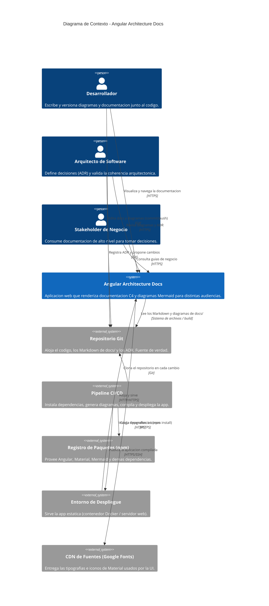

# Diagrama de Contexto del Sistema (C4 - Nivel 1)

## Descripción general

El diagrama de contexto es el nivel más alto del modelo C4. Representa el sistema
como una única caja y lo sitúa en su entorno: quién lo usa (personas) y con qué
otros sistemas se integra. No describe tecnología interna ni contenedores; su
objetivo es dejar claro el **alcance del sistema** y sus **fronteras**.

## Sistema bajo análisis

**Angular Architecture Docs** es una aplicación web (Angular 20) que permite
documentar y visualizar arquitecturas de software con el modelo C4. Toma
definiciones de diagramas escritas como texto (Mermaid) junto a la documentación
en Markdown del repositorio, y las renderiza de forma interactiva para distintas
audiencias.

## Diagrama de contexto

> Si tu visor no soporta la notación `C4Context` de Mermaid, el mismo contenido
> está descrito en las tablas de inventario y relaciones de más abajo, que son la
> fuente autoritativa de este diagrama.

## Inventario de personas (actores)

| Actor | Rol | Responsabilidades | Restricciones |
|-------|-----|-------------------|---------------|
| Desarrollador | Autor técnico | Escribir diagramas Mermaid y documentación; versionarlos junto al código | Debe seguir la convención de carpetas `docs/` y la sintaxis Mermaid válida |
| Arquitecto de Software | Dueño de las decisiones | Crear y mantener ADR; validar patrones y relaciones entre componentes | Las decisiones deben quedar trazadas en `docs/decisions/` |
| Stakeholder de Negocio | Lector no técnico | Consultar guías de negocio y resúmenes para decidir | Acceso solo de lectura; depende de documentación sin jerga técnica |

## Inventario de sistemas externos

| Sistema | Propósito | Relación con el sistema | Restricciones |
|---------|-----------|-------------------------|---------------|
| Repositorio Git | Fuente de verdad del código y la documentación | Provee los Markdown/diagramas que la app renderiza; recibe los cambios de personas | Requiere permisos de escritura para publicar cambios |
| Pipeline CI/CD | Automatizar build y despliegue | Orquesta `npm install`, generación de diagramas y publicación | Depende de la disponibilidad del registro npm y del entorno de despliegue |
| Registro de Paquetes (npm) | Distribuir dependencias | Entrega Angular, Material, Mermaid, etc. durante la instalación | Las versiones declaradas deben existir y ser compatibles con Angular 20 |
| Entorno de Despliegue | Ejecutar y servir la app | Aloja el bundle estático (Docker / servidor web) | Sirve archivos estáticos; sin backend propio en el alcance actual |
| CDN de Fuentes (Google Fonts) | Tipografías e iconos | La UI carga Roboto y los iconos de Material en tiempo de ejecución | Dependencia externa en runtime; requiere conectividad del navegador |

## Detalle de relaciones

| # | Origen | Destino | Interacción | Protocolo |
|---|--------|---------|-------------|-----------|
| 1 | Desarrollador | Angular Architecture Docs | Visualiza y navega la documentación | HTTPS |
| 2 | Arquitecto | Angular Architecture Docs | Revisa diagramas y ADR | HTTPS |
| 3 | Stakeholder | Angular Architecture Docs | Consulta guías de negocio | HTTPS |
| 4 | Desarrollador | Repositorio Git | Edita docs y diagramas (commit/push) | Git |
| 5 | Arquitecto | Repositorio Git | Registra ADR y propone cambios | Git |
| 6 | Pipeline CI/CD | Repositorio Git | Clona en cada cambio | Git |
| 7 | Pipeline CI/CD | Registro npm | Instala dependencias | HTTPS |
| 8 | Pipeline CI/CD | Entorno de Despliegue | Publica la app compilada | HTTPS/SSH |
| 9 | Angular Architecture Docs | Repositorio Git | Lee los Markdown y diagramas de `docs/` | Build / FS |
| 10 | Entorno de Despliegue | Angular Architecture Docs | Aloja y sirve la aplicación | HTTP/HTTPS |
| 11 | Angular Architecture Docs | CDN de Fuentes | Carga tipografías e iconos | HTTPS |

## Alcance y fronteras

**Dentro del alcance (el sistema):** la aplicación Angular que renderiza
documentación y diagramas C4, su navegación entre niveles y la presentación
adaptada a cada audiencia.

**Fuera del alcance (sistemas externos):** el versionado (Git), la automatización
(CI/CD), la distribución de dependencias (npm), el hosting (entorno de
despliegue) y la entrega de fuentes (CDN). El sistema interactúa con ellos pero no
los implementa.

## Supuestos

- La documentación y los diagramas viven en el repositorio como archivos de texto
  (Markdown + Mermaid); no hay base de datos ni backend propio en este nivel.
- La generación de diagramas ocurre en tiempo de build (`npm run generate:docs`),
  y el resultado se sirve como contenido estático.

## Siguiente nivel

Para ver cómo se estructura internamente el sistema y qué contenedores lo
componen, consultar el [Diagrama de Contenedores](../container/diagrama-contenedor.md).

---

*Nivel 1 (Contexto) del modelo C4. Para actualizar este diagrama, editar este
archivo en `docs/context/`.*
