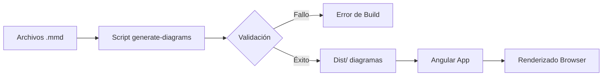

# Guía Técnica de Arquitectura

## Resumen Ejecutivo

Este documento describe la arquitectura técnica del sistema de documentación arquitectónica, detallando los componentes, sus responsabilidades, las tecnologías empleadas y las decisiones de diseño que guían la implementación. El sistema está diseñado como una aplicación Angular standalone que genera y sirve documentación técnica basada en el modelo C4.

## Visión General de la Arquitectura

La aplicación sigue una arquitectura de documentación automatizada que separa la generación de diagramas, el almacenamiento de contenido y la presentación. Esta separación permite modificar cualquiera de los componentes de forma independiente, facilitando el mantenimiento y la evolución del sistema.

```
┌─────────────────────────────────────────────────────────────────┐
│                     Navegador del Usuario                       │
│  ┌─────────────────────────────────────────────────────────┐   │
│  │              Aplicación Angular (SPA)                    │   │
│  │   Componentes de Presentación → Servicios → Router      │   │
│  └─────────────────────────────────────────────────────────┘   │
└─────────────────────────────────────────────────────────────────┘
                              │
                              ▼
┌─────────────────────────────────────────────────────────────────┐
│                    Servidor de Desarrollo                      │
│  Angular CLI (ng serve) → Proxy requests → Archivos estáticos  │
└─────────────────────────────────────────────────────────────────┘
                              │
                              ▼
┌─────────────────────────────────────────────────────────────────┐
│                    Sistema de Archivos                          │
│  docs/ (Markdown) → scripts/ (generación) → dist/ (build)      │
└─────────────────────────────────────────────────────────────────┘
```

## Stack Tecnológico

### Framework Principal
- **Angular 20**: Framework de desarrollo frontend con soporte para standalone components
- **TypeScript 5.8**: lenguaje de programación con tipado estático
- **RxJS 7.8**: Biblioteca para programación reactiva en manejo de eventos asíncronos

### Herramientas de Visualización
- **Mermaid 10.9**: Motor de generación de diagramas desde texto
- **Angular Material 17**: Componentes UI preconstruidos para experiencia consistente

### Infraestructura
- **Node.js 20**: Entorno de ejecución para build y desarrollo
- **Docker**: Contenedor para despliegue reproducible
- **NPM 10+**: Gestor de paquetes y scripts de build

## Arquitectura de Componentes

### Capa de Presentación
La capa de presentación implementa el patrón de componentes standalone de Angular, donde cada componente encapsula su propia lógica de presentación y dependencias. Los componentes se organizan en estructuras de carpetas que reflejan su responsabilidad dentro de la aplicación.

**Responsabilidades**:
- Renderizado de diagramas Mermaid en el navegador
- Navegación entre diferentes vistas de documentación
- Interacción con el usuario para zoom y navegación de diagramas
- Aplicación de estilos y theming consistente

**Componentes clave**:
- DiagramViewer: Renderiza diagramas desde definición textual
- ContextNavigator: Facilita navegación entre niveles C4
- DocumentationReader: Presentación de contenido Markdown

### Capa de Servicios
Los servicios actúan como intermediarios entre los componentes y las fuentes de datos, implementando la lógica de negocio y la comunicación con sistemas externos.

**Servicios principales**:
- DiagramService: Carga y procesa definiciones de diagramas Mermaid
- DocumentationService: Gestiona carga de archivos Markdown
- NavigationService: Controla el estado de navegación entre vistas
- ThemeService: Administra preferencias de visualización

### Capa de Datos
La capa de datos abstrae el acceso a la información, permitiendo que las capas superiores permanezcan independientes de la implementación de almacenamiento subyacente.

**Fuentes de datos**:
- Archivos Markdown estáticos en el sistema de archivos
- Definiciones de diagramas en formato Mermaid (.mmd)
- Configuración de aplicación en archivos JSON

## Modelo de Despliegue

### Desarrollo Local
El entorno de desarrollo utiliza Angular CLI con servidor de desarrollo integrado. El comando `ng serve` inicia un servidor con hot-reload que refleja los cambios en tiempo real durante el desarrollo.

```bash
npm install
npm start
# Acceder a http://localhost:4200
```

### Producción
El build de producción genera archivos estáticos optimizados que pueden servirse desde cualquier servidor web capaz de servir archivos estáticos.

```bash
npm run build
# Archivos generados en dist/angular-architecture-docs
```

### Contenedor Docker
La aplicación se contruye como imagen Docker para despliegue reproducible:

```dockerfile
FROM node:20-alpine
WORKDIR /app
COPY package*.json ./
RUN npm ci --only=production
COPY . .
RUN npm run build
EXPOSE 80
CMD ["npx", "http-server", "dist/angular-architecture-docs"]
```

## Patrones de Diseño Implementados

### Inyección de Dependencias
Angular utiliza su sistema de inyección de dependencias para gestionar las dependencias entre servicios y componentes. Los servicios se registran como providers a nivel de aplicación o de componente según su ámbito de uso.

```typescript
@Component({
  standalone: true,
  providers: [DiagramService]
})
export class DiagramViewerComponent {
  constructor(private diagramService: DiagramService) {}
}
```

### Componentes Standalone
Los componentes standalone eliminan la necesidad de módulos NgModule, permitiendo que cada componente defina sus propias importaciones y dependencias. Este patrón reduce la complejidad y mejora el tree-shaking durante el build.

### Señales para Estado Reactivo
Angular Signals proporciona un modelo de reactividad granular que optimiza la detección de cambios. Los servicios exponen señales para estado que los componentes consumen de forma reactiva.

```typescript
@Injectable({ providedIn: 'root' })
export class ThemeService {
  private _isDarkMode = signal(false);
  
  readonly isDarkMode = this._isDarkMode.asReadonly();
  
  toggleTheme() {
    this._isDarkMode.update(v => !v);
  }
}
```

## Flujo de Generación de Diagramas

El pipeline de generación de diagramas sigue un flujo estructurado que garantiza consistencia entre la definición textual y el resultado visual:

1. **Authoring**: Los diagramas se definen en archivos .mmd dentro de docs/
2. **Validación**: Script de build verifica sintaxis Mermaid antes del build
3. **Generación**: Mermaid procesa las definiciones y genera SVG/PNG
4. **Integración**: Los diagramas se incrustan en la aplicación
5. **Renderizado**: El componente DiagramViewer renderiza en el navegador



## Consideraciones de Seguridad

### Content Security Policy
La aplicación configura CSP para restringir fuentes de contenido y prevenir XSS. Los scripts de Mermaid se ejecutan en contexto aislado.

### Sanitización de Entrada
Todo contenido Markdown se sanitiza antes de renderizarse para prevenir inyección de scripts maliciosos. Angular HttpClient configura headers de seguridad por defecto.

### Dependencias Actualizadas
El proyecto mantiene dependencias actualizadas mediante revisión periódica de vulnerabilidades conocidas. npm audit ejecuta automáticamente en el pipeline de CI.

## Métricas y Monitorización

### Core Web Vitals
La aplicación optimiza para las métricas de Core Web Vitals:
- **LCP (Largest Contentful Paint)**: < 2.5s - Optimizado con lazy loading de diagramas
- **FID (First Input Delay)**: < 100ms - Código modular con chunking eficiente
- **CLS (Cumulative Layout Shift)**: < 0.1 - Dimensiones fijas para diagramas

### Performance de Build
- Tiempo de build frío: < 60 segundos
- Tiempo de build caliente: < 10 segundos
- Tamaño del bundle: < 500KB (gzipped)

## Contribución y Mantenimiento

### Estructura de Ramas
- `main`: Rama de producción
- `develop`: Rama de integración
- `feature/*`: Nuevas funcionalidades
- `docs/*`: Actualizaciones de documentación

### Proceso de Pull Request
1. Crear rama desde develop
2. Implementar cambios con tests correspondientes
3. Actualizar documentación si aplica
4. Solicitar revisión
5. Merge después de aprobación

### Guidelines de Código
- Strict TypeScript habilitado
- ESLint con configuración estricta
- Conventional Commits para mensajes de commit
- Cobertura de tests > 80%

## Referencias y Recursos

- [Documentación Angular](https://angular.io/docs)
- [Guía de Estilos Angular](https://angular.io/guide/styleguide)
- [Mermaid.js](https://mermaid.js.org/)
- [Modelo C4](https://c4model.com/)
- [Angular Material](https://material.angular.io/)

---
*Documento generado automáticamente. Última actualización: Enero 2025*